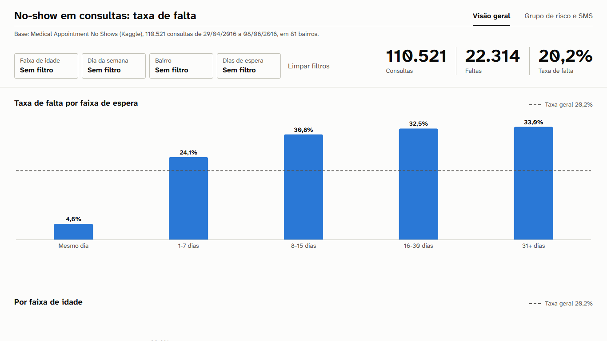
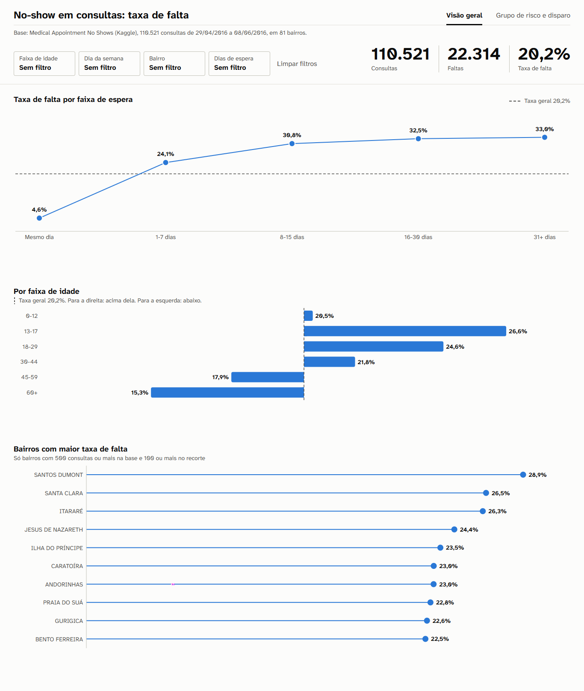
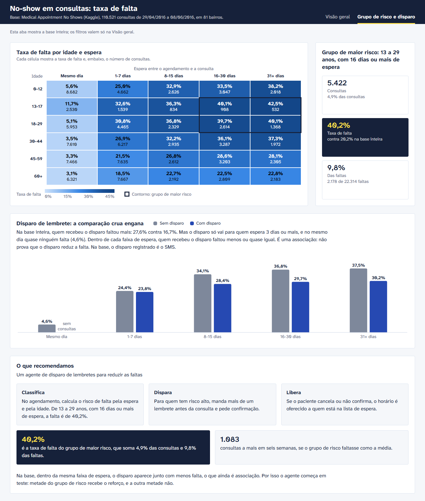

# Redução de faltas em consultas (no-show) em clínicas

Projeto final de **Análise de Dados e BI**, com o professor Daniel Brandão.

**Equipe:** Cauê Franco, Lucio Lima e Daniel Vieira.

**Dashboard:** <https://cauedev30.github.io/analise-no-show-consultas/>



O projeto parte de uma base pública de consultas, limpa os dados, analisa quem falta mais e termina numa recomendação.
Tudo o que está aqui sai de **uma só base tratada** (`dados/tratados/consultas_tratadas.csv`), com as mesmas definições
e os mesmos números nos notebooks, no dashboard, nos documentos e nos slides.

## O problema

No-show é quando o paciente marca a consulta e não comparece, sem avisar. A clínica perde capacidade de atendimento:
o horário vago não é reaproveitado e quem estava na fila não consegue vaga. Nos dados deste projeto, cerca de 1 em
cada 5 agendados falta (**20,2%**).

**Pergunta central:** quem tem mais chance de faltar e o que a clínica pode fazer para reduzir isso?

**Setor:** Saúde Privada. A base usada indica consultas da rede pública (tem a coluna de Bolsa Família e bairros de
Vitória, ES) e entra como **aproximação** do comportamento de falta numa clínica. A premissa está explicada na seção
**D** do [processo](docs/processo.md).

### Os quatro pontos da proposta

| Ponto | Como ficou |
|---|---|
| **Problema** | Cerca de 1 em cada 5 pacientes agendados falta à consulta (20,2%). O horário vago não é reaproveitado e quem está na fila fica sem vaga |
| **Dataset** | *Medical Appointment No Shows* (Kaggle): 110.527 consultas, 14 colunas, única fonte do projeto |
| **Ferramenta** | Python (Pandas, Matplotlib, Seaborn) em notebooks Jupyter para a limpeza, a análise e os números do dashboard; uma página web (Next.js/React) para exibir o dashboard; GitHub para o código, a documentação e a publicação |
| **Objetivo da solução** | Mostrar quem tem mais chance de faltar e recomendar uma ação: um agente de disparo de lembretes, que dá atenção extra ao grupo de maior risco |

A ferramenta do dashboard e a solução mudaram em relação à proposta. O que mudou e por quê está em
["O que mudou"](docs/processo.md#o-que-mudou-de-uma-entrega-para-a-outra-e-por-quê), no processo.

## Fonte dos dados

- **Base:** *Medical Appointment No Shows*, do Kaggle: https://www.kaggle.com/datasets/joniarroba/noshowappointments
- **Autor:** Joni Hoppen (Aquarela Analytics).
- **Licença:** [CC BY-NC-SA 4.0](https://creativecommons.org/licenses/by-nc-sa/4.0/). A base tratada deste repositório é uma
  obra derivada e segue a mesma licença (atribuição, uso não comercial e compartilhamento pela mesma licença).
- **O que tem:** 110.527 consultas e 14 colunas. As consultas vão de 2016-04-29 a 2016-06-08.
- O arquivo original (`dados/original/KaggleV2-May-2016.csv`) **nunca é alterado**: a limpeza só lê esse arquivo e grava o
  resultado em outro lugar (`dados/tratados/`).

**Como os dados foram obtidos.** Baixamos o arquivo do link acima em 2026-11-10: um `.zip` de 2,5 MB com um único CSV,
`KaggleV2-May-2016.csv` (10,7 MB). Esse CSV foi colocado em `dados/original/` sem nenhuma alteração. Não houve coleta
própria, raspagem nem junção com outra base: **é a única fonte de dados do projeto**. O SHA-256 do arquivo é
`9132d3e7d0246617df9041d3764f20ad6f08e7b0d9f0997fa254fc5e52eda27d`, o mesmo do CSV que está dentro do `.zip` baixado e do arquivo enviado ao professor. Os números que
descrevem o original (110.527 consultas, 62.299 pacientes, 81 bairros, 22.319 faltas) saem de
`python scripts/perfil_dataset.py dados/original/KaggleV2-May-2016.csv`.

## O caminho dos dados

```
Kaggle (única fonte)
  → dados/original/ (intocado)
  → notebook 01 (limpeza)
  → dados/tratados/consultas_tratadas.csv (única base)
        ├─ notebook 02 (um fator de cada vez)
        ├─ notebook 03 (espera x idade, grupo de maior risco)
        └─ scripts/gerar_dados_dashboard.py → painel.json → dashboard (página web)
```

O original só é lido. A base tratada alimenta os dois notebooks de análise e o script que calcula os números do
dashboard. **O Python calcula, a página só mostra.** O diagrama completo está em
[Como as peças se ligam](docs/processo.md#como-as-peças-se-ligam).

## Limpeza: [notebooks/01_limpeza.ipynb](notebooks/01_limpeza.ipynb)

O passo a passo completo, com o porquê de cada decisão, está em [docs/processo.md](docs/processo.md). O notebook tem 9
passos. Cada um traz o problema, a decisão, a justificativa, o antes e depois e uma checagem automática (`assert`).

| Passo | Problema | Decisão | Linhas afetadas |
|---|---|---|---|
| 1. Nomes das colunas | Grafia errada (`Hipertension`, `Handcap`), hífen (`No-show`), inglês e estilos misturados | Renomear as 14 colunas para português, em minúsculas e com `_` | 0 (14 colunas renomeadas) |
| 2. Datas | Datas em texto, com hora e fuso (`Z`); a consulta nunca tem horário | Converter para data `AAAA-MM-DD`, sem converter o fuso | 0 (2 colunas convertidas) |
| 3. Idade negativa | 1 consulta com idade -1 | Remover | **1 removida** |
| 4. Consulta antes do agendamento | 5 consultas com data anterior ao agendamento (de -6 a -1 dia) | Remover | **5 removidas** |
| 5. Idade 0 e acima de 100 | 3.539 consultas com idade 0 e 7 com idade acima de 100 (115 anos x5, 102 anos x2) | Manter: são raras, mas possíveis | 0 (nenhuma removida) |
| 6. Coluna `deficiencia` | Vai de 0 a 4, e a fonte não explica o que 2, 3 e 4 significam | Manter de 0 a 4 e criar `tem_deficiencia` (0 ou 1) no passo 8 | 0 (nenhuma removida) |
| 7. `faltou` | `No-show` tem `Yes`/`No`, e o "No" duplo confunde | Criar `faltou`: 1 = faltou, 0 = compareceu | 0 (1 coluna convertida) |
| 8. Colunas derivadas | Faltam grupos prontos para a análise | Criar `dias_espera`, `dia_semana`, `faixa_etaria`, `faixa_espera` e `tem_deficiencia` | 0 (5 colunas criadas) |
| 9. Conferência final e gravação | Garantir que a base está certa e o original intocado | Rodar as checagens, gravar o CSV, reler e conferir o hash do original | 0 |

**Resumo do que entrou e do que saiu:**

| Item | Consultas | Faltas |
|---|---|---|
| Consultas no original | 110.527 | 22.319 |
| Removidas no passo 3: idade negativa (-1) | -1 | 0 |
| Removidas no passo 4: consulta antes do agendamento | -5 | -5 |
| **Consultas na base tratada** | **110.521** | **22.314** |

São **6 linhas removidas** (110.527 para 110.521) e 14 colunas viraram 19. As 5 consultas do passo 4 eram todas faltas,
por isso as faltas caem de 22.319 para 22.314, e a taxa de falta continua em 20,2%.

**Definições oficiais** (iguais em todo o projeto): taxa de falta = faltas ÷ consultas, em %; espera = dias de
calendário entre o agendamento e a consulta (a base só traz a data, sem o horário). Faixas de idade: `0-12`, `13-17`,
`18-29`, `30-44`, `45-59` e `60+`. Faixas de espera: `Mesmo dia`, `1-7 dias`, `8-15 dias`, `16-30 dias` e `31+ dias`.

## Análise

Os dois notebooks leem só a base tratada. Cada seção tem a pergunta, o código, o gráfico e uma leitura com os números
que o próprio notebook calculou. Os achados são **descritivos**: mostram associação, não causa.

**Um nome só: "disparo de lembrete".** Na solução, o envio de lembrete se chama **disparo de lembrete**, porque o canal
pensado é o WhatsApp. Na base, o disparo registrado é o SMS (coluna `recebeu_sms`), e o notebook 02 fala em SMS, como a
base.

### Primeira análise: [notebooks/02_exploracao.ipynb](notebooks/02_exploracao.ipynb)

Um fator de cada vez, em 8 seções:

1. **A espera é o fator mais associado à falta.** Quem marca para o mesmo dia falta em **4,6%** das consultas; quem
   marca com antecedência, em **28,5%**. A partir de 16 dias a taxa passa de **32%** (32,5% e 33,0%) e praticamente
   para de crescer. Os dias de espera também têm a maior correlação com a falta (0,19), ainda que fraca.
2. **O disparo de lembrete (SMS na base) parece aumentar a falta, mas é correlação espúria.** Na comparação crua, quem
   recebeu SMS falta mais (**27,6%** com SMS contra **16,7%** sem). Mas nenhuma consulta do mesmo dia recebeu SMS, e
   dentro de cada faixa de espera a taxa com SMS é menor (por exemplo, 28,4% contra 34,1% em 8 a 15 dias, e 30,2% contra
   37,5% em 31 dias ou mais). Isso é uma **associação**, não prova que o disparo reduz a falta; mostra que a comparação
   crua estava contaminada pela espera.
3. **Adolescentes e jovens faltam mais; quem tem 60+ falta menos.** 13 a 17 anos: **26,6%**; 18 a 29: **24,6%**; 60
   anos ou mais: **15,3%** (taxa geral: 20,2%).
4. **O dia da semana quase não importa.** De segunda a sexta a taxa fica entre **19,3%** e **21,2%**. O sábado (39
   consultas) é amostra pequena demais para concluir.
5. **Alguns bairros se destacam, com cautela.** Entre os 54 bairros com 500 consultas ou mais, **SANTOS DUMONT** tem a
   maior taxa (**28,9%**). É uma pista, não uma conclusão.

### Grupo de maior risco: [notebooks/03_grupo_de_risco.ipynb](notebooks/03_grupo_de_risco.ipynb)

O notebook 02 deixou uma dúvida: os jovens faltam mais por serem jovens ou por marcarem com mais antecedência? O
notebook 03 cruza a idade com a espera (6 faixas x 5 faixas) em 4 seções:

1. **A idade e a espera pesam juntas.** Em todas as idades a falta sobe com a espera. A célula mais alta é a de 13 a 17
   anos com 31 dias ou mais (**42,5%**); a mais baixa, a de 60 anos ou mais no mesmo dia (**3,1%**). As quatro maiores
   células são as de 13 a 29 anos com 16 dias ou mais de espera.
2. **O grupo de maior risco** (13 a 29 anos **e** 16 dias ou mais de espera): **5.422 consultas**, **4,9%** da agenda,
   falta em **40,2%** (o dobro da taxa geral) e concentra **9,8% das faltas**. A espera longa sozinha (16 dias ou mais, em
   todas as idades) tem 26.246 consultas (23,7%), falta em 32,7% e concentra 38,5% das faltas.
3. **O tamanho do problema.** O grupo tem 2.178 faltas; na taxa geral teria cerca de 1.095. A diferença são **1.083
   consultas a mais em seis semanas**. É o tamanho do problema, e não quantas faltas um lembrete evitaria.
4. **Leitura e limites.**

## O dashboard

Link: <https://cauedev30.github.io/analise-no-show-consultas/>. É uma página web (Next.js/React) publicada no GitHub
Pages deste repositório, com **duas abas**. O script [`scripts/gerar_dados_dashboard.py`](scripts/gerar_dados_dashboard.py)
lê a base tratada e grava os números em `dashboard/public/dados/painel.json`; a página só mostra esse arquivo. A única
conta que ela faz é a dos filtros: somar as consultas e as faltas do recorte e dividir, pela mesma definição de taxa de
falta.

- **Visão geral.** Uma barra fixa no topo, sempre à vista, com os 4 filtros (faixa de idade, dia da semana, bairro e
  dias de espera) e 3 números (consultas, faltas e taxa de falta). Embaixo, 3 seções que mudam com os filtros: a taxa
  de falta por faixa de espera (linha com pontos, na largura toda) e, lado a lado, por faixa de idade (barras de desvio da taxa geral) e os bairros com
  maior taxa (pirulito, só os que têm 500 consultas ou mais e, com filtro, 100 ou mais no recorte).
- **Grupo de risco e disparo.** O mapa de calor de idade x espera com o grupo de maior risco contornado; o disparo de
  lembrete (a comparação crua e a comparação dentro de cada faixa de espera); e o bloco "O que recomendamos". Esta aba
  mostra sempre a base inteira.





## O que recomendamos

**Um agente de disparo de lembretes para reduzir as faltas.** O projeto **sugere** a solução e não a constrói. O agente
faz três coisas, uma atrás da outra:

| Passo | O que faz |
|---|---|
| **Classifica** | No agendamento, calcula o risco de falta pela espera e pela idade. De 13 a 29 anos, com 16 dias ou mais de espera, a falta é de **40,2%** |
| **Dispara** | Para quem tem risco alto, manda mais de um lembrete antes da consulta e pede confirmação. O canal pensado é o WhatsApp |
| **Libera** | Se o paciente cancela ou não confirma, o horário é oferecido a quem está na lista de espera |

**Por quê, pelos números:** o grupo de maior risco é pequeno (4,9% da agenda) e fácil de achar no agendamento, falta em
40,2% e soma **1.083 consultas a mais em seis semanas**, se faltasse como a média.

**Limites:** é associação, não causa. Na base, dentro da mesma faixa de espera, o disparo aparece junto com menos falta,
o que ainda é associação. Por isso o agente **começa em teste**: metade do grupo de risco recebe o reforço, e a outra
metade não. Os 1.083 são o tamanho do problema, não quantas faltas o lembrete evitaria. Os dados indicam a rede pública e
entram como aproximação; a clínica deve repetir o cruzamento com a própria agenda antes de aplicar. A base não tem o
horário da consulta, só a data, e por isso o risco é medido pela espera. A explicação completa está na seção **S** do
[processo](docs/processo.md#s-sugira-decisões).

## As entregas ao professor e este repositório

O projeto final usa **o mesmo material** das entregas já feitas: a mesma fonte, o mesmo arquivo original, a mesma
limpeza, as mesmas definições e os mesmos números. Nada aqui contradiz um envio anterior.

| Entrega | O que foi enviado | Onde está neste repositório |
|---|---|---|
| **Proposta do tema** (2026-11-03, aprovada) | Tema, problema, fatores a analisar (espera, idade, dia da semana e lembrete), entregáveis e o dataset | [O problema](#o-problema), seções 2 a 5 do [notebook 02](notebooks/02_exploracao.ipynb) e seção **S** do [processo](docs/processo.md) |
| **Entrega 2: Dados** (2026-11-10) | Fonte, autor e licença, descrição da base, dicionário das 14 colunas e os 7 pontos a tratar na limpeza | [Fonte dos dados](#fonte-dos-dados) e os 9 passos do [notebook 01](notebooks/01_limpeza.ipynb), que tratam os 7 pontos um a um |
| **Entrega 3: dados tratados, limpeza e primeira análise** (2026-11-18) | O link deste repositório e o resumo da etapa | `dados/original/`, `dados/tratados/`, os notebooks 01 e 02 e o [processo](docs/processo.md) |
| **Projeto final** (feito em 2026-11-24; enviado pelo link deste repositório) | Dashboard (página web), a análise do grupo de maior risco, a recomendação e a apresentação executiva (slides e dashboard) | [Notebook 03](notebooks/03_grupo_de_risco.ipynb), [`scripts/`](scripts/), [`dashboard/`](dashboard/), o [dashboard publicado](https://cauedev30.github.io/analise-no-show-consultas/), o [guia de estudo](docs/guia-de-estudo.md) e o [plano](docs/plano-projeto-final.md) |

A conferência ponto a ponto (o que cada entrega disse e onde isso foi cumprido) e o que mudou de uma entrega para a
outra estão nas seções [Coerência com as entregas ao professor](docs/processo.md#coerência-com-as-entregas-ao-professor)
e [O que mudou](docs/processo.md#o-que-mudou-de-uma-entrega-para-a-outra-e-por-quê) do processo. A apresentação tem de
5 a 10 minutos: 7 slides (a capa e um por letra do D.E.I.L.A.S) e depois o dashboard ao vivo. O conteúdo dos slides, as
decisões com o porquê e as perguntas que o professor pode fazer estão no [guia de estudo](docs/guia-de-estudo.md).

## Estrutura das pastas

```
.
├── README.md
├── requirements.txt                       # bibliotecas Python, com versões fixas
├── dados/
│   ├── original/KaggleV2-May-2016.csv     # a base do Kaggle, intocada
│   └── tratados/consultas_tratadas.csv    # base tratada: 110.521 linhas, 19 colunas
├── notebooks/
│   ├── 01_limpeza.ipynb                   # limpeza (lê o original, grava a base tratada)
│   ├── 02_exploracao.ipynb                # primeira análise (lê só a base tratada)
│   └── 03_grupo_de_risco.ipynb            # espera x idade, grupo de maior risco (lê só a base tratada)
├── scripts/
│   ├── perfil_dataset.py                  # conferência inicial do dataset original
│   └── gerar_dados_dashboard.py           # lê a base tratada e grava dashboard/public/dados/painel.json
├── tests/
│   └── test_dados_dashboard.py            # testes Python: confere o painel.json contra os números oficiais
├── dashboard/                             # a página web (Next.js/React)
│   ├── app/, components/, lib/            # o código da página e os testes dela
│   ├── public/dados/painel.json           # os números que a página mostra (gerados pelo script)
│   └── imagens/                           # prints do dashboard
├── docs/
│   ├── processo.md                        # o como e o porquê de cada etapa (método D.E.I.L.A.S)
│   ├── guia-de-estudo.md                  # resumo para a equipe estudar e o conteúdo dos slides
│   └── plano-projeto-final.md             # o plano do projeto final, tarefa a tarefa
└── .github/workflows/publicar-dashboard.yml   # roda lint, testes e build e publica no GitHub Pages
```

## Como rodar

Os notebooks foram executados com Python 3.12 e pandas 3.0. O dashboard precisa do Node 22.12 ou mais novo (testado com
o 24). Os comandos abaixo partem da raiz do repositório.

**1. Instalar as bibliotecas Python**

```bash
pip install -r requirements.txt
```

**2. Notebooks.** Abra o Jupyter (`jupyter lab`) e execute, em ordem e do começo ao fim, `notebooks/01_limpeza.ipynb`,
`notebooks/02_exploracao.ipynb` e `notebooks/03_grupo_de_risco.ipynb`. Eles usam caminhos relativos à pasta
`notebooks/`. O 01 lê o original e grava a base tratada; o 02 e o 03 só leem a base tratada (o 03 confere o hash dela).

**3. Números do dashboard.** O `painel.json` já está no repositório. Para gerar de novo a partir da base tratada:

```bash
python scripts/gerar_dados_dashboard.py
```

**4. Testes Python.** Conferem os dados e o `painel.json` contra os números oficiais (18 testes):

```bash
python -m pytest tests/ -q
```

**5. Dashboard.** Dentro da pasta `dashboard/`:

```bash
cd dashboard
npm ci          # instala as dependências, nas versões do package-lock.json
npm test        # 79 testes das contas e dos componentes (Vitest)
npm run lint    # confere o código
npm run dev     # abre em http://localhost:3000
npm run build   # gera o site estático em dashboard/out/
```

A cada push que mexe em `dashboard/`, o GitHub Actions roda o lint, os testes e o build e publica o site no GitHub Pages.

**Nota técnica ao abrir a base tratada no Excel ou em outra ferramenta:** importe `paciente_id` como **texto**. Ele é só
um identificador, e 5 IDs vêm escritos como `NNNNE-5` no original (por exemplo `9377952927E-5`) e foram mantidos assim.
Importados como número, o programa pode alterá-los.
