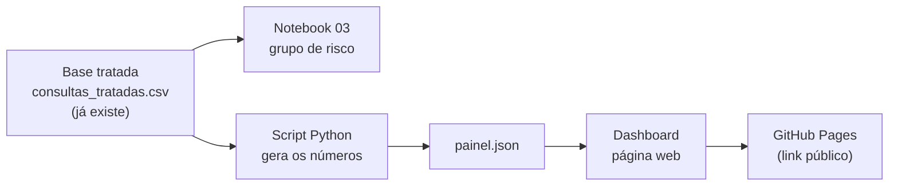

# Plano do projeto final

**Projeto:** redução de faltas em consultas (no-show) em clínicas · **Equipe:** Cauê Franco, Lucio Lima e Daniel Vieira
· **Disciplina:** Análise de Dados e BI, professor Daniel Brandão.

Este é o plano do que falta fazer, em ordem, com o que cada tarefa entrega e como sabemos que ela está pronta. O que
foi decidido e por quê está no [guia de estudo](guia-de-estudo.md); o detalhe do que já foi feito está no
[processo](processo.md).

Escrito em 2026-11-23. As caixas são marcadas conforme as tarefas terminam.

## O caminho dos dados

O Python faz todas as contas. A página só mostra os números do `painel.json`; a única conta dela é a dos filtros
(somar as consultas e as faltas do recorte escolhido e dividir).

## O que não muda

- O arquivo original e a base tratada. Um teste confere a "impressão digital" (o hash) dos dois.
- A limpeza (notebook 01) e a primeira análise (notebook 02).
- As definições: taxa de falta = faltas ÷ consultas; espera em dias de calendário; as mesmas faixas de idade e de espera.

## Etapa 1: notebook 03, o grupo de maior risco

O notebook 02 olhou um fator de cada vez. O 03 cruza os dois que mais pesam, a espera e a idade.

| | Tarefa | Pronto quando |
|---|---|---|
| ☑ | 1.1 Abertura e carga da base tratada | O notebook lê só a base tratada e confere 110.521 consultas e 22.314 faltas |
| ☑ | 1.2 O cruzamento de idade e espera, com mapa de calor | As 30 combinações somam o total da base |
| ☑ | 1.3 O grupo de maior risco (16 dias ou mais de espera e 13 a 29 anos): tamanho, taxa e parte das faltas | O grupo calculado pelas faixas é igual ao calculado pela idade e pelos dias de espera |
| ☑ | 1.4 Onde o overbooking faz sentido: faltas esperadas a cada 100 consultas, por faixa de espera | As taxas batem com as do notebook 02 |
| ☑ | 1.5 Leitura, limites e execução do zero | O notebook roda do começo ao fim sem erro |

**Entrega da etapa:** o número do slide **S**.

## Etapa 2: os números do dashboard, em Python

| | Tarefa | Pronto quando |
|---|---|---|
| ☑ | 2.1 Fixar as versões das bibliotecas no `requirements.txt` | A instalação não troca nenhuma versão |
| ☑ | 2.2 `scripts/gerar_dados_dashboard.py`: lê a base tratada e grava o `painel.json` | Rodar duas vezes dá o mesmo arquivo |
| ☑ | 2.3 `tests/test_dados_dashboard.py`: confere o arquivo contra os números oficiais | Todos os testes passam |

O que o `painel.json` guarda: as consultas e as faltas de cada combinação de idade, dia da semana, bairro e espera
(para os filtros); os totais; os bairros com 500 consultas ou mais; o cruzamento de idade e espera; o grupo de maior
risco; e a taxa com e sem SMS em cada faixa de espera.

## Etapa 3: o dashboard e a publicação

Uma página web (Next.js/React) com duas abas, publicada no GitHub Pages.

| | Tarefa | Pronto quando |
|---|---|---|
| ☐ | 3.1 Criar o projeto da página | O site é gerado como arquivos estáticos, sem servidor |
| ☐ | 3.2 Leitura dos dados e a conta dos filtros | Sem filtro, a conta devolve os totais oficiais; os testes passam |
| ☐ | 3.3 Estrutura da página, as duas abas e o estilo | A página é legível no projetor |
| ☐ | 3.4 Aba **Visão geral**: 4 filtros, 3 cartões e 4 gráficos | Com os filtros limpos: 110.521 consultas, 22.314 faltas e 20,2% |
| ☐ | 3.5 Aba **Grupo de risco e SMS**: mapa de calor, grupo de maior risco, SMS e recomendações | Os números batem com o notebook 03 |
| ☐ | 3.6 Publicação no GitHub Pages | O link público abre e mostra os números certos |
| ☐ | 3.7 Conferência na tela e os dois prints | Os prints estão no repositório |

**Entrega da etapa:** o link do dashboard e os prints para os slides.

## Etapa 4: documentação

| | Tarefa | Pronto quando |
|---|---|---|
| ☐ | 4.1 `docs/processo.md`: o notebook 03, as recomendações com os números e o dashboard | Nada feito aparece como "próxima etapa" |
| ☐ | 4.2 `README.md` reescrito para o projeto inteiro, com o link e o print do dashboard | Seguir o "como rodar" do zero funciona |
| ☐ | 4.3 `docs/guia-de-estudo.md`: o número do slide S, o link e o passo a passo da demonstração | Não sobra nenhum "a fazer" |
| ☐ | 4.4 Texto de "próximos passos" do notebook 02 | Só o texto muda; nenhum número |

## Etapa 5: conferência final e envio

| | Tarefa | Pronto quando |
|---|---|---|
| ☐ | 5.1 Conferência de coerência | Os números oficiais aparecem iguais no README, no processo, no guia, no dashboard e nos slides |
| ☐ | 5.2 Execução do zero em uma cópia limpa do repositório | Notebooks, script, testes e dashboard rodam sem erro |
| ☐ | 5.3 Ensaio da apresentação (slides e dashboard) | Cabe em 5 a 10 minutos |
| ☐ | 5.4 Envio ao professor | Link do repositório e do dashboard enviados |

## Os slides

Os slides são montados em paralelo, a partir do [guia de estudo](guia-de-estudo.md): a capa e um slide por letra do
D.E.I.L.A.S. Os slides 1 a 6 já podem ser feitos. O slide **S** recebe o número da etapa 1, e o dashboard entra na
apresentação depois da etapa 3.
