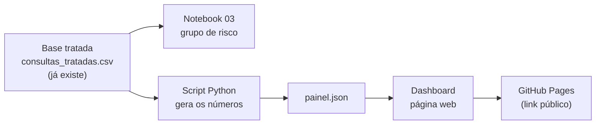

# Plano do projeto final

**Projeto:** redução de faltas em consultas (no-show) em clínicas · **Equipe:** Cauê Franco, Lucio Lima e Daniel Vieira
· **Disciplina:** Análise de Dados e BI, professor Daniel Brandão.

Este é o plano do que falta fazer, em ordem, com o que cada tarefa entrega e como sabemos que ela está pronta. O que
foi decidido e por quê está no [guia de estudo](guia-de-estudo.md); o detalhe do que já foi feito está no
[processo](processo.md).

Escrito em 2026-11-23. As caixas são marcadas conforme as tarefas terminam.

## O caminho dos dados

O Python faz todas as contas. A página só mostra os números do `painel.json`; a única conta dela é a dos filtros
(somar as consultas e as faltas do recorte escolhido e dividir).

## O que não muda

- O arquivo original e a base tratada. Um teste confere a "impressão digital" (o hash) dos dois.
- A limpeza (notebook 01) e a primeira análise (notebook 02).
- As definições: taxa de falta = faltas ÷ consultas; espera em dias de calendário; as mesmas faixas de idade e de espera.

## Etapa 1: notebook 03, o grupo de maior risco

O notebook 02 olhou um fator de cada vez. O 03 cruza os dois que mais pesam, a espera e a idade.

| | Tarefa | Pronto quando |
|---|---|---|
| ☑ | 1.1 Abertura e carga da base tratada | O notebook lê só a base tratada e confere 110.521 consultas e 22.314 faltas |
| ☑ | 1.2 O cruzamento de idade e espera, com mapa de calor | As 30 combinações somam o total da base |
| ☑ | 1.3 O grupo de maior risco (16 dias ou mais de espera e 13 a 29 anos): tamanho, taxa e parte das faltas | O grupo calculado pelas faixas é igual ao calculado pela idade e pelos dias de espera |
| ☑ | 1.4 Onde o overbooking faz sentido: faltas esperadas a cada 100 consultas, por faixa de espera | As taxas batem com as do notebook 02 |
| ☑ | 1.5 Leitura, limites e execução do zero | O notebook roda do começo ao fim sem erro |

**Entrega da etapa:** o número do slide **S**.

## Etapa 2: os números do dashboard, em Python

| | Tarefa | Pronto quando |
|---|---|---|
| ☑ | 2.1 Fixar as versões das bibliotecas no `requirements.txt` | A instalação não troca nenhuma versão |
| ☑ | 2.2 `scripts/gerar_dados_dashboard.py`: lê a base tratada e grava o `painel.json` | Rodar duas vezes dá o mesmo arquivo |
| ☑ | 2.3 `tests/test_dados_dashboard.py`: confere o arquivo contra os números oficiais | Todos os testes passam |

O que o `painel.json` guarda: as consultas e as faltas de cada combinação de idade, dia da semana, bairro e espera
(para os filtros); os totais; os bairros com 500 consultas ou mais; o cruzamento de idade e espera; o grupo de maior
risco; e a taxa com e sem SMS em cada faixa de espera.

## Etapa 3: o dashboard e a publicação

Uma página web (Next.js/React) com duas abas, publicada no GitHub Pages.

| | Tarefa | Pronto quando |
|---|---|---|
| ☑ | 3.1 Criar o projeto da página | O site é gerado como arquivos estáticos, sem servidor |
| ☑ | 3.2 Leitura dos dados e a conta dos filtros | Sem filtro, a conta devolve os totais oficiais; os testes passam |
| ☑ | 3.3 Estrutura da página, as duas abas e o estilo | A página é legível no projetor |
| ☑ | 3.4 Aba **Visão geral**: 4 filtros, 3 cartões e 4 gráficos | Com os filtros limpos: 110.521 consultas, 22.314 faltas e 20,2% |
| ☑ | 3.5 Aba **Grupo de risco e SMS**: mapa de calor, grupo de maior risco, SMS e recomendações | Os números batem com o notebook 03 |
| ☑ | 3.6 Publicação no GitHub Pages | O link público abre e mostra os números certos |
| ☑ | 3.7 Conferência na tela e os dois prints | Os prints estão no repositório |

**Entrega da etapa:** o link do dashboard e os prints para os slides.

**Publicado em 2026-11-24:** https://cauedev30.github.io/analise-no-show-consultas/ (a cada push que mexe em `dashboard/`,
o GitHub Actions roda o lint, os testes e o build e publica de novo). Colunas com menos de 100 consultas aparecem em
azul claro, como amostra pequena (por exemplo, o sábado, com 39 consultas).

## Etapa 3B: o dashboard com rolagem e surgimento suave

**O que mudou:** a aba **Visão geral** estava acumulada para caber numa tela só. Nenhum conteúdo saiu: a regra "tudo
numa tela" caiu, os 4 gráficos viraram seções na largura toda (espera, idade, dia da semana e bairros, na ordem da fala)
e os filtros e os 3 números ficam numa barra presa no topo. **Por quê:** cada achado ganha espaço e entra na tela quando
é comentado; mudar um filtro lá embaixo mostra o efeito na hora. Saíram o rodapé e o bloco "Ideia de aplicação" e
"Limites" do fim de "O que recomendamos" (os dois seguem nos slides e no guia de estudo).

| | Tarefa | Pronto quando |
|---|---|---|
| ☑ | 3B.1 Tirar o rodapé e o bloco de ideia e limites | As duas recomendações continuam, com os números do painel |
| ☑ | 3B.2 O surgimento das seções | Cada seção surge uma vez ao entrar na tela; com "reduzir movimento", tudo aparece direto |
| ☑ | 3B.3 Aba **Visão geral** em seções, com a barra fixa | A primeira tela mostra a barra e o gráfico da espera inteiro; filtro não anima |
| ☑ | 3B.4 Aba **Grupo de risco e SMS** com o surgimento | As 3 seções surgem; layout e números iguais |
| ☑ | 3B.5 Publicação, conferência no site e os três prints | O site publicado passa na conferência |

**Publicado em 2026-11-24**, no mesmo link. Sem JavaScript (ou enquanto ele carrega, na primeira visita) a página mostra
tudo; o surgimento só esconde o que está fora da tela. Quem usa "reduzir movimento" no sistema vê tudo direto, sem
animação.

## Etapa 3C: um tipo de gráfico para cada achado

**O que mudou:** na aba **Visão geral**, a espera virou **linha com pontos**, a idade virou **barras de desvio da taxa
geral** (para a direita, acima de 20,2%; para a esquerda, abaixo) e os bairros viraram **pirulito**. O gráfico do dia
da semana saiu; o filtro ficou. **Por quê:** estava tudo em barras, e cada forma agora mostra o tipo do achado (uma
progressão, quem fica acima ou abaixo da média, um ranking). O dia da semana quase não muda a taxa (19,3% a 21,2%), o
que cabe numa frase do slide **A**.

| | Tarefa | Pronto quando |
|---|---|---|
| ☑ | 3C.1 A conta do desvio da taxa geral | Sem filtro, cada faixa de idade fica a taxa oficial menos 20,2% |
| ☑ | 3C.2 Espera em linha com pontos | A primeira tela ainda mostra o gráfico da espera inteiro |
| ☑ | 3C.3 Idade em barras de desvio | Filtrando espera "Mesmo dia", todas as barras vão para a esquerda |
| ☑ | 3C.4 Bairros em pirulito e a saída do gráfico do dia da semana | 3 seções; o filtro do dia da semana continua |
| ☑ | 3C.5 Publicação, conferência no site e os prints | O site publicado passa na conferência |

**Publicado em 2026-11-24**, no mesmo link.

## Etapa 3D: o agente de disparo de lembretes no lugar do overbooking

**O que mudou:** a solução passou a ser uma só, um **agente de disparo de lembretes** que classifica o risco de falta
no agendamento, dispara mais de um lembrete com pedido de confirmação para quem tem risco alto e libera o horário para
a lista de espera quando o paciente cancela ou não confirma. O overbooking saiu do notebook 03 e do dashboard. Na tela,
o "SMS" passou a se chamar **disparo de lembrete**; na base, o disparo registrado é o SMS (coluna `recebeu_sms`). Número
novo: **1.083** consultas a mais em seis semanas, se o grupo de maior risco faltasse como a média. **Por quê:** o grupo
preferiu uma solução só, e o enunciado não pede um número de soluções (a proposta citava as ações como exemplos); o
agente completa o lembrete, confirma a consulta e reaproveita o horário vago. O nome "disparo de lembrete" é o mesmo
nos slides e no dashboard, porque o canal pensado hoje é o WhatsApp, não o SMS.

| | Tarefa | Pronto quando |
|---|---|---|
| ☑ | 3D.1 Notebook 03 com o agente e a conta do 1.083 | O notebook roda do zero e as seções 1 e 2 não mudam |
| ☑ | 3D.2 O número novo no `painel.json` | O teste confere 1.083 pela conta das outras chaves |
| ☑ | 3D.3 "O que recomendamos" vira o agente | Os números vêm do painel, não digitados |
| ☑ | 3D.4 O SMS vira "disparo de lembrete" na tela | "SMS" só na frase que liga à base; nenhum "overbooking" |
| ☐ | 3D.5 Publicação, conferência no site e o print da aba 2 | O site publicado passa na conferência |

## Etapa 4: documentação

| | Tarefa | Pronto quando |
|---|---|---|
| ☐ | 4.1 `docs/processo.md`: o notebook 03, as recomendações com os números e o dashboard | Nada feito aparece como "próxima etapa" |
| ☐ | 4.2 `README.md` reescrito para o projeto inteiro, com o link e o print do dashboard | Seguir o "como rodar" do zero funciona |
| ☐ | 4.3 `docs/guia-de-estudo.md`: o número do slide S, o link e o passo a passo da demonstração | Não sobra nenhum "a fazer" |
| ☐ | 4.4 Texto de "próximos passos" do notebook 02 | Só o texto muda; nenhum número |

## Etapa 5: conferência final e envio

| | Tarefa | Pronto quando |
|---|---|---|
| ☐ | 5.1 Conferência de coerência | Os números oficiais aparecem iguais no README, no processo, no guia, no dashboard e nos slides |
| ☐ | 5.2 Execução do zero em uma cópia limpa do repositório | Notebooks, script, testes e dashboard rodam sem erro |
| ☐ | 5.3 Ensaio da apresentação (slides e dashboard) | Cabe em 5 a 10 minutos |
| ☐ | 5.4 Envio ao professor | Link do repositório e do dashboard enviados |

## Os slides

Os slides são montados em paralelo, a partir do [guia de estudo](guia-de-estudo.md): a capa e um slide por letra do
D.E.I.L.A.S. Os slides 1 a 6 já podem ser feitos. O slide **S** recebe o número da etapa 1, e o dashboard entra na
apresentação depois da etapa 3.
