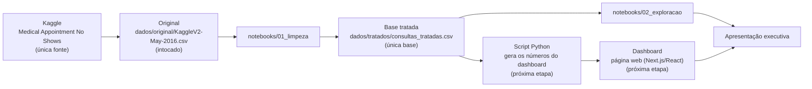

# Processo: como a limpeza e a análise foram feitas

**Projeto:** redução de faltas em consultas (no-show) em clínicas · **Equipe:** Cauê Franco, Lucio Lima e Daniel Vieira
· **Disciplina:** Análise de Dados e BI, professor Daniel Brandão.

Este documento explica **o que fizemos e por quê**, na ordem do método **D.E.I.L.A.S** da aula: **D**efina o objetivo,
**E**stabeleça métricas, **I**dentifique fontes, **L**impe as bases, **A**nalise os dados e **S**ugira decisões. Ele serve
de roteiro para a equipe explicar o processo em voz alta na apresentação. O [README](../README.md) é a porta de entrada
curta; aqui está o detalhe.

**Tudo é interligado.** A base tratada (`dados/tratados/consultas_tratadas.csv`) é a **única base** da análise e do
dashboard. As definições (taxa de falta, espera, faixas) e os números são os mesmos no código, no README, neste
documento, no dashboard e nos slides. Se um número mudar, ele muda em todos os lugares.

---

## D: Defina o objetivo

**A dor.** No-show é quando o paciente marca a consulta e não comparece, sem avisar. A clínica perde capacidade de
atendimento: o horário vago não é reaproveitado e quem estava na fila não consegue vaga. Nos nossos dados, cerca de 1
em cada 5 agendados falta (**20,2%**).

**A pergunta central.** Quem tem mais chance de faltar e o que a clínica pode fazer para reduzir isso?

**Por que este tema.** O problema é comum, fácil de explicar e tem uma base pública boa para analisar (uma tabela só,
sem juntar várias fontes). O escopo é enxuto de propósito: limpeza, análise, dashboard e recomendações, sem API, banco
nem deploy.

**Setor e premissa.** O setor do projeto é **Saúde Privada**, como na proposta aprovada. A base, porém, traz a coluna de
Bolsa Família e bairros de Vitória (ES), o que indica consultas da **rede pública**. Não existe base pública equivalente
de clínicas privadas, então usamos esta como **aproximação** do comportamento de falta. A premissa é que os fatores
ligados à falta (principalmente o tempo de espera) também valem numa clínica privada. Antes de aplicar as recomendações,
a clínica deve conferir os números com os próprios dados de agendamento.

---

## E: Estabeleça métricas

Estas são as **definições oficiais**. Valem iguais no notebook, no README, neste documento, no dashboard e nos slides.

| Métrica | Definição |
|---|---|
| **Taxa de falta** | consultas com `faltou = 1` ÷ total de consultas, em %. Na base tratada: 22.314 ÷ 110.521 = **20,2%** |
| **Espera** (`dias_espera`) | dias de **calendário** entre o agendamento e a consulta (`data_consulta − data_agendamento`). A consulta só tem a data, sem horário, então a espera só pode ser contada em dias |

**As faixas e por que cada uma tem esses cortes.** Os rótulos são sempre estes (com hífen simples, para não dar problema
no Power BI). O dashboard usa as mesmas faixas e não cria faixas próprias.

| Faixa | Rótulos | Por que esses cortes |
|---|---|---|
| Idade (`faixa_etaria`) | `0-12`, `13-17`, `18-29`, `30-44`, `45-59`, `60+` | Agrupam fases da vida: crianças (0-12), adolescentes (13-17), adultos jovens (18-29), adultos (30-44 e 45-59) e 60 anos ou mais |
| Espera (`faixa_espera`) | `Mesmo dia`, `1-7 dias`, `8-15 dias`, `16-30 dias`, `31+ dias` | `Mesmo dia` (0 dias) é uma situação à parte: marcar e ir no mesmo dia. Os outros cortes seguem o calendário: até uma semana, até uma quinzena, até um mês e mais de um mês |
| Dia da semana (`dia_semana`) | `Segunda`, `Terça`, `Quarta`, `Quinta`, `Sexta`, `Sábado` | O dia da semana da consulta. Não há consultas aos domingos |

Os cortes foram fechados antes da análise. Depois, os dados mostraram que a taxa de falta sobe até 16 a 30 dias e quase
não sobe mais na faixa de 31 dias ou mais.

---

## I: Identifique fontes

- **Base:** *Medical Appointment No Shows*, do Kaggle: https://www.kaggle.com/datasets/joniarroba/noshowappointments
- **Autor:** Joni Hoppen (Aquarela Analytics).
- **Licença:** CC BY-NC-SA 4.0. A base tratada é uma obra derivada e segue a mesma licença.
- **Volume:** 110.527 consultas e 14 colunas. **Período:** consultas de 2016-04-29 a 2016-06-08; os agendamentos vão de
  2015-11-10 a 2016-06-08.
- **Como os dados foram obtidos:** baixamos o arquivo do link acima em 2026-11-10. O download é um `.zip` de 2,5 MB com
  um único CSV, `KaggleV2-May-2016.csv` (10,7 MB), que foi colocado em `dados/original/` sem nenhuma alteração. Não
  houve coleta própria, raspagem nem junção com outra base: **é a única fonte de dados do projeto**, como dissemos na
  Entrega 2.
- **Conferência do original:** os números que descrevem a base (110.527 consultas, 14 colunas, 62.299 pacientes, 81
  bairros, 22.319 faltas, sem nulos e sem duplicatas) saem do script
  [`scripts/perfil_dataset.py`](../scripts/perfil_dataset.py), rodado sobre o arquivo original. São os mesmos números
  da Entrega 2.
- **Taxa de falta:** 20,2%. O subtítulo do Kaggle diz "30%", mas o número real, medido nos dados, é 20,2%.
- **Foto do original** (seção "Preparação" do [notebook de limpeza](../notebooks/01_limpeza.ipynb)): sem valores nulos e sem linhas duplicadas. Os problemas estão escondidos nos valores e nos nomes, e é
  isso que a limpeza trata.
- **Regra de ouro:** o arquivo original **não se altera nunca**. Para provar, o notebook confere o hash SHA-256 do
  original no começo e no fim da limpeza, e os dois são iguais:
  `9132d3e7d0246617df9041d3764f20ad6f08e7b0d9f0997fa254fc5e52eda27d`. É o mesmo hash do CSV que está
  dentro do `.zip` baixado do Kaggle e do arquivo enviado ao professor (conferido em 2026-11-20).

---

## L: Limpe as bases

A limpeza está no notebook [01_limpeza](../notebooks/01_limpeza.ipynb), em **9 passos**. Cada passo tem o mesmo
formato: **Problema**, **Decisão**, **Justificativa**, o código, o antes e depois e um `assert` (uma checagem que para o
notebook se algo estiver errado).

**Em uma frase:** partimos de 110.527 consultas, corrigimos nomes e datas, removemos 6 linhas impossíveis (1 com idade
negativa e 5 com consulta antes do agendamento), mantivemos o que é raro mas possível, criamos a coluna `faltou` e as
colunas derivadas, e chegamos a **110.521 consultas e 19 colunas** na base tratada.

### Passo 1: nomes das colunas

- **Problema:** alguns nomes têm a grafia errada (`Hipertension`, `Handcap`), um tem hífen (`No-show`) e todos estão em
  inglês, com estilos misturados (`PatientId`, `SMS_received`).
- **Decisão:** renomear as 14 colunas para português, em minúsculas e com `_`.
- **Por quê:** nomes corretos e padronizados evitam erro de digitação. O hífen de `No-show` atrapalha em fórmulas e no
  Power BI. Em português, a equipe e o professor leem as colunas sem tradução.
- **Linhas afetadas:** 0 (14 colunas renomeadas, na mesma ordem do original).
- **Onde ver:** [Passo 1](../notebooks/01_limpeza.ipynb) no notebook de limpeza.

| Original | Tratada | Original | Tratada |
|---|---|---|---|
| `PatientId` | `paciente_id` | `Hipertension` | `hipertensao` |
| `AppointmentID` | `consulta_id` | `Diabetes` | `diabetes` |
| `Gender` | `sexo` | `Alcoholism` | `alcoolismo` |
| `ScheduledDay` | `data_agendamento` | `Handcap` | `deficiencia` |
| `AppointmentDay` | `data_consulta` | `SMS_received` | `recebeu_sms` |
| `Age` | `idade` | `No-show` | `faltou` |
| `Neighbourhood` | `bairro` | `Scholarship` | `bolsa_familia` |

### Passo 2: datas

- **Problema:** `ScheduledDay` e `AppointmentDay` são texto (por exemplo `2016-04-29T18:38:08Z`). O agendamento tem
  hora, mas a consulta vem sempre com `00:00:00`: a base não diz o horário da consulta.
- **Decisão:** converter as duas colunas para **data** (`AAAA-MM-DD`), descartando a hora e o fuso. A espera passa a
  ser contada em dias de calendário.
- **Por quê:** como a consulta não tem horário, a espera só pode ser contada em dias, e por isso a hora do agendamento é
  descartada. O `Z` no fim do texto diz "horário UTC", mas os agendamentos acontecem entre 6h e 21h, com pico às 7h
  (19.213 agendamentos). Isso é horário de funcionamento de clínica, ou seja, tudo indica que é o **horário local
  rotulado errado como UTC**. Por isso **não convertemos o fuso**: pegamos a data como está escrita, que é o dia que a
  clínica e o paciente viram. Converter deslocaria horários e faria algumas datas mudarem de dia sem motivo.
- **Linhas afetadas:** 0 (2 colunas convertidas, sem nulos).
- **Onde ver:** [Passo 2](../notebooks/01_limpeza.ipynb) no notebook de limpeza.

### Passo 3: idade negativa

- **Problema:** 1 consulta com idade **-1**, o que é impossível.
- **Decisão:** remover essa linha.
- **Por quê:** é 1 linha em 110.527 e não há como descobrir a idade verdadeira. Chutar um valor seria inventar dado.
  Remover não muda nenhuma taxa de forma perceptível.
- **Linhas afetadas:** **1 removida** (110.527 para 110.526). Essa linha não era falta (`No-show = No`).
- **Onde ver:** [Passo 3](../notebooks/01_limpeza.ipynb) no notebook de limpeza.

### Passo 4: consultas antes do agendamento

- **Problema:** 5 consultas têm data **anterior** ao dia em que foram agendadas (de -6 a -1 dia de diferença). Não dá
  para ir à consulta antes de marcá-la.
- **Decisão:** remover as 5 linhas.
- **Por quê:** são impossíveis, e não temos como saber qual das duas datas está errada, então não dá para corrigir. Se
  ficassem, teriam **espera negativa**, e a espera é justamente a variável central da nossa análise.
- **Linhas afetadas:** **5 removidas** (110.526 para 110.521).
- **Efeito nas faltas:** as 5 eram todas faltas (`No-show = Yes`). Por isso as faltas passam de 22.319 para 22.314, e a
  taxa de falta continua em 20,2%, porque 5 linhas em mais de 110 mil quase não mexem na proporção.
- **Onde ver:** [Passo 4](../notebooks/01_limpeza.ipynb) no notebook de limpeza.

### Passo 5: idade 0 e idade acima de 100 (ficam)

- **Problema:** duas faixas de idade parecem estranhas: **3.539** consultas com idade **0** e **7** com idade acima de
  100 (5 com 115 anos e 2 com 102).
- **Decisão:** manter as duas. Nenhuma linha é removida.
- **Por quê:** idade 0 são bebês com menos de 1 ano, o que é perfeitamente possível numa consulta. Acima de 100 é raro,
  mas possível, e não temos prova de que seja erro. São só 7 linhas em mais de 110 mil, então não mudam as taxas. Elas
  caem na faixa `60+`.
- **Linhas afetadas:** 0.
- **Onde ver:** [Passo 5](../notebooks/01_limpeza.ipynb) no notebook de limpeza.

### Passo 6: coluna `deficiencia` (0 a 4)

- **Problema:** a fonte descreve essa coluna (`Handcap`) como verdadeiro/falso, mas ela vai de **0 a 4**, e a fonte não
  explica o que 2, 3 e 4 significam (talvez o número de deficiências, talvez o tipo).
- **Decisão:** manter o valor como está, de 0 a 4, e registrar a dúvida. No Passo 8 criamos também `tem_deficiencia`
  (0 ou 1).
- **Por quê:** não dá para "corrigir" o que não sabemos. Manter o valor não perde informação, e a versão 0/1 usa só o que
  é seguro afirmar: acima de 0 significa que a pessoa tem alguma deficiência registrada.
- **Linhas afetadas:** 0. (Na base tratada: 108.282 com 0, 2.040 com 1, 183 com 2, 13 com 3 e 3 com 4.)
- **Onde ver:** [Passo 6](../notebooks/01_limpeza.ipynb) no notebook de limpeza.

### Passo 7: `faltou` (0 ou 1)

- **Problema:** a coluna `No-show` guarda `Yes` (faltou) e `No` (compareceu). O nome tem um "No" duplo que confunde:
  `No-show = No` quer dizer "não faltou".
- **Decisão:** criar `faltou`: **1** para `Yes` (faltou) e **0** para `No` (compareceu).
- **Por quê:** com 0 e 1, a **média** da coluna já é a taxa de falta, e a soma é o número de faltas. O nome `faltou = 1`
  se lê direto, sem dupla negação.
- **Linhas afetadas:** 0. (88.207 compareceram e 22.314 faltaram.)
- **Onde ver:** [Passo 7](../notebooks/01_limpeza.ipynb) no notebook de limpeza.

### Passo 8: colunas derivadas

- **Problema:** para analisar a falta por espera, por idade e por dia da semana, faltam as colunas já em grupos.
- **Decisão:** criar 5 colunas a partir das que já existem: `dias_espera` (em dias, de 0 a 179), `dia_semana`,
  `faixa_etaria`, `faixa_espera` (as três com os rótulos da seção **E** deste documento) e `tem_deficiencia` (1 se
  `deficiencia` for maior que 0).
- **Por quê:** as faixas têm cortes fechados e rótulos fixos, que valem **igual** no notebook 02, no dashboard e nos
  slides. O dia da semana é calculado pelo número do dia, para não depender do idioma do computador.
- **Linhas afetadas:** 0 (5 colunas criadas; passamos de 14 para 19 colunas).
- **Onde ver:** [Passo 8](../notebooks/01_limpeza.ipynb) no notebook de limpeza.

### Passo 9: conferência final e gravação

- **Problema:** antes de entregar a base, precisamos ter certeza de que ela está certa e de que o original não foi
  tocado.
- **Decisão:** reordenar as colunas, rodar as checagens finais, mostrar a tabela-resumo do que entrou e do que saiu,
  gravar o CSV, reler o arquivo gravado e conferir de novo o hash do original.
- **Por quê:** quem usar a base depois (notebook 02 e dashboard) confia que ela já está limpa. Reler o arquivo gravado
  garante que o que está no disco é igual ao que tínhamos na memória (datas em `AAAA-MM-DD`, identificadores sem virar
  número).
- **Linhas afetadas:** 0. O resultado é `dados/tratados/consultas_tratadas.csv`, com 110.521 linhas e 19 colunas, sem
  nulos e sem duplicatas.
- **Onde ver:** [Passo 9](../notebooks/01_limpeza.ipynb) no notebook de limpeza.

### Resumo: o que entrou e o que saiu

| Item | Consultas | Faltas |
|---|---|---|
| Consultas no original | 110.527 | 22.319 |
| Removidas no passo 3: idade negativa (-1) | -1 | 0 |
| Removidas no passo 4: consulta antes do agendamento | -5 | -5 |
| **Consultas na base tratada** | **110.521** | **22.314** |

Colunas: 14 no original e 19 na base tratada. Taxa de falta: 20,2% no original e 20,2% na base tratada (continua a
mesma).

### O que **não** foi mexido, e por quê

| O que ficou | Por quê |
|---|---|
| **Idade 0** (3.539 consultas) | São bebês com menos de 1 ano, o que é possível numa consulta ([Passo 5](../notebooks/01_limpeza.ipynb)) |
| **Idade acima de 100** (7 consultas) | É raro, mas possível, e não há prova de erro. São 7 linhas e não mudam as taxas ([Passo 5](../notebooks/01_limpeza.ipynb)) |
| **Deficiência de 0 a 4** | Não sabemos o que 2, 3 e 4 significam, e não dá para corrigir o que não sabemos. Manter não perde informação ([Passo 6](../notebooks/01_limpeza.ipynb)) |
| **Sábados** (39 consultas) | Poucas consultas. Nada é removido: a cautela vai para a leitura da análise, porque a taxa de grupos muito pequenos oscila muito |
| **Bairros com poucas consultas** (5 dos 81 bairros têm menos de 50) | Idem: nada é removido. Na análise, o ranking de bairros só considera os que têm pelo menos 500 consultas |
| **Fuso das datas** | Não foi convertido, porque os horários indicam que o `Z` está errado ([Passo 2](../notebooks/01_limpeza.ipynb)) |
| **`paciente_id`** | É só um rótulo, gravado como texto exatamente como veio. 5 IDs vêm escritos como `NNNNE-5` no original (por exemplo `9377952927E-5`) e ficam assim |

---

## A: Analise os dados

A primeira análise está no notebook [02_exploracao](../notebooks/02_exploracao.ipynb). Ela lê **só** a base tratada e
tem 8 seções, cada uma com a pergunta, o código, o gráfico e uma leitura com os números que o próprio notebook calculou.

| Seção | Pergunta |
|---|---|
| Seção 1 | Qual é a taxa de falta geral? |
| Seção 2 | O tempo de espera pesa na falta? |
| Seção 3 | O SMS reduz a falta? (o caso da correlação espúria) |
| Seção 4 | Quem falta mais por idade? |
| Seção 5 | Algum dia da semana falha mais? |
| Seção 6 | Quais bairros têm mais falta? |
| Seção 7 | Como as variáveis numéricas se correlacionam com a falta? |
| Seção 8 | Achados e próximos passos |

### O que a análise mostrou

1. **A espera é o fator mais associado à falta** ([Seção 2](../notebooks/02_exploracao.ipynb) no notebook de
   exploração). Quem marca para o mesmo dia falta em **4,6%** das consultas (1.792 de 38.562); quem marca com
   antecedência, em **28,5%** (20.522 de 71.959), cerca de 6,1 vezes mais. Por faixa: 1-7 dias, 24,1%; 8-15 dias,
   30,8%; 16-30 dias, 32,5%; 31+ dias, 33,0%. A partir de 16 dias a taxa passa de **32%** e praticamente para de
   crescer. Os dias de espera também têm a maior correlação com a falta (0,19), ainda que fraca
   ([Seção 7](../notebooks/02_exploracao.ipynb)).
2. **O SMS é o caso de correlação espúria** ([Seção 3](../notebooks/02_exploracao.ipynb)). Uma correlação espúria é
   quando duas coisas andam juntas nos números, mas a relação aparente vem de um terceiro fator escondido. A história,
   em passos:
   - **Comparação crua:** quem recebeu SMS falta em **27,6%** (9.784 de 35.482) e quem não recebeu, em **16,7%**
     (12.530 de 75.039). À primeira vista, o SMS parece aumentar a falta.
   - **O fator escondido é a espera:** nenhuma consulta do mesmo dia recebeu SMS (o SMS só aparece a partir de 3 dias
     de espera: as 50.500 consultas com 0, 1 ou 2 dias não tiveram nenhum). O grupo "sem SMS" fica cheio de consultas
     do mesmo dia, que quase não faltam (4,6%), e isso puxa a taxa dele para baixo. A correlação entre SMS e dias de
     espera é 0,40.
   - **Comparando dentro de cada faixa de espera**, a taxa com SMS é menor em todas: 24,4% sem SMS contra 23,8% com
     SMS (1 a 7 dias), 34,1% contra 28,4% (8 a 15), 36,8% contra 29,7% (16 a 30) e 37,5% contra 30,2% (31 dias ou mais).
     Em 1 a 7 dias a diferença é praticamente nula, e de 8 dias em diante é de cerca de 6 a 7 pontos percentuais.
   - **Cuidado:** isso é uma **associação**, e **não prova** que o SMS reduz a falta. Quem recebe SMS não foi sorteado
     (pode ser, por exemplo, quem deixou telefone no cadastro). Saber se o SMS reduz a falta exigiria um teste
     controlado.
3. **Adolescentes e jovens faltam mais; quem tem 60+ falta menos** ([Seção 4](../notebooks/02_exploracao.ipynb)). 13 a
   17 anos: **26,6%**; 18 a 29: **24,6%**; 60 anos ou mais: **15,3%** (taxa geral: 20,2%). Crianças de 0 a 12: 20,5%.
4. **O dia da semana quase não importa** ([Seção 5](../notebooks/02_exploracao.ipynb)). De segunda a sexta a taxa fica
   entre **19,3%** e **21,2%**. O sábado (39 consultas) é amostra pequena demais para concluir.
5. **Alguns bairros se destacam, com cautela** ([Seção 6](../notebooks/02_exploracao.ipynb)). Dos 81 bairros, 54 têm 500
   consultas ou mais e entram na comparação. O corte existe porque, com poucas consultas, a taxa é puro acaso: o bairro
   ILHAS OCEÂNICAS DE TRINDADE tem 100% de falta, mas são só 2 consultas. Entre os 54, **SANTOS DUMONT** tem a maior taxa
   (**28,9%**, 1.276 consultas). É uma pista para o dashboard, não uma conclusão.

### Limites desta primeira versão

A análise é **descritiva**: olha um fator de cada vez, sem controlar vários ao mesmo tempo, e a base não traz o horário
da consulta (só a data). Por isso os resultados são **hipóteses bem fundamentadas nos dados**, não provas de causa. Todas
as correlações com a falta são fracas (a maior é 0,19), mas isso não quer dizer "sem efeito": as variáveis são quase todas
0/1, e a relação com a espera não é linear (a taxa para de crescer a partir de 16 dias).

---

## S: Sugira decisões

Duas recomendações, ainda como **hipóteses a validar** no dashboard:

1. **Lembrete reforçado para o grupo de maior risco.** Pelos achados, o grupo combina **espera longa (16 dias ou mais)**
   e **idade entre 13 e 29 anos**. Reforçar quer dizer, por exemplo, mais de um contato antes da consulta. Atenção: a
   primeira análise olhou cada fator separado e **não cruzou os dois**. Por isso o dashboard precisa mostrar o tamanho
   desse grupo e a taxa dele antes de a equipe propor a ação.
2. **Overbooking controlado, pela espera.** Marcar um pouco acima da capacidade nos recortes com mais falta, para
   reaproveitar os horários vagos. Como a base **não tem o horário da consulta**, o recorte será pela espera (o fator
   mais associado à falta). Dia da semana e bairro só entram se o dashboard mostrar diferença. O limite do overbooking
   precisa ser calculado com cuidado para não gerar fila.

**O que o dashboard vai validar:** a taxa de falta com filtros por **idade, dia da semana, bairro e dias de espera**,
sobre a mesma base tratada e com as mesmas faixas e definições. Ele vai mostrar o tamanho e a taxa do grupo da
recomendação 1 e se há diferença por dia e por bairro para a recomendação 2.

---

## Como as peças se ligam

- O arquivo do **Kaggle** foi baixado e guardado como veio: é o **original**.
- O **original** só é lido, nunca alterado.
- O notebook **01** limpa e grava a **base tratada**.
- O notebook **02** e o **dashboard** partem da **mesma** base tratada. No dashboard, um script Python lê a base tratada
  e grava os números em um arquivo; a página web só mostra esses números. O dashboard não refaz a limpeza nem cria
  faixas próprias: usa as mesmas definições e os mesmos rótulos da seção **E**.
- A **apresentação** reúne os achados da análise e do dashboard e as recomendações.

---

## Coerência com as entregas ao professor

O projeto final usa **o mesmo material** das entregas já feitas: a mesma fonte, o mesmo arquivo original, a mesma
limpeza, as mesmas definições e os mesmos números. Esta seção mostra, ponto a ponto, o que cada entrega disse e onde
isso está no projeto.

### Proposta do tema (2026-11-03, aprovada)

| O que a proposta disse | Como está no projeto |
|---|---|
| Tema: redução de faltas em consultas (no-show) em clínicas | O mesmo tema e a mesma pergunta central (seção **D**) |
| Setor: Saúde Privada | O mesmo setor. Os dados indicam rede pública e são usados como aproximação, com a premissa declarada na seção **D** |
| "Cerca de 20% dos pacientes agendados não comparecem" | Medido nos dados: **20,2%** (22.319 de 110.527 no original; 22.314 de 110.521 na base tratada) |
| Fatores a analisar: tempo de espera, idade, dia da semana e envio de lembrete | Seções 2 (espera), 4 (idade), 5 (dia da semana) e 3 (SMS) do [notebook 02](../notebooks/02_exploracao.ipynb) |
| Recomendar lembretes direcionados aos grupos de maior risco e overbooking controlado | As duas recomendações da seção **S** |
| Script de limpeza em Python | [notebook 01](../notebooks/01_limpeza.ipynb) (feito) |
| Exploração com Pandas e Seaborn | [notebook 02](../notebooks/02_exploracao.ipynb), com Pandas, Matplotlib e Seaborn (feito) |
| Dashboard interativo com filtros no Power BI | Próxima etapa, sobre a base tratada, com os mesmos filtros. A ferramenta mudou para uma página web (ver "O que mudou", abaixo) |
| Apresentação executiva de 10 a 15 minutos | Próxima etapa, em 5 a 10 minutos (ver "O que mudou", abaixo) |
| Dataset: *Medical Appointment No Shows* (Kaggle) | O mesmo, e é o único (seção **I**) |

### Entrega 2: Dados (2026-11-10)

A Entrega 2 descreveu a fonte e o arquivo original. Tudo o que ela afirmou continua valendo:

| O que a Entrega 2 disse | Como está no projeto |
|---|---|
| Fonte, autor, licença e link | Os mesmos (seção **I** e README) |
| "É a única fonte de dados do projeto" | Continua sendo: nenhuma outra base entrou |
| 110.527 consultas, 62.299 pacientes, 81 bairros | Os mesmos números, tirados do `scripts/perfil_dataset.py` |
| Consultas de 29/04/2016 a 08/06/2016; agendamentos desde 10/11/2015 | O mesmo período (seção **I**) |
| Taxa de falta de 20,2% (22.319 das 110.527 consultas) | O mesmo no original. Na base tratada: 22.314 de 110.521, ainda 20,2% |
| Dicionário das 14 colunas | As mesmas 14 colunas, renomeadas no Passo 1 (a tabela de/para está lá) |
| Base utilizada: o CSV original, sem alterações, com a limpeza em Python preservando o original | O original fica em `dados/original/`, e o hash prova que não mudou |

A Entrega 2 também listou **7 pontos para a etapa de limpeza**. Cada um foi tratado em um passo do notebook 01:

| Ponto listado na Entrega 2 | Onde foi tratado | O que foi feito |
|---|---|---|
| 1 registro com idade negativa (-1) | Passo 3 | Removido |
| 5 consultas com data anterior à do agendamento | Passo 4 | Removidas |
| Nomes de coluna com erro de grafia e com hífen | Passo 1 | As 14 colunas foram renomeadas |
| `Handcap` vai de 0 a 4, e a fonte diz verdadeiro/falso | Passo 6 (e Passo 8) | Mantido de 0 a 4, com a dúvida registrada; criada `tem_deficiencia` (0 ou 1) |
| `AppointmentDay` só tem a data; a espera será em dias | Passo 2 e Passo 8 | Datas convertidas; `dias_espera` em dias de calendário |
| `No-show` em Yes/No precisa virar 0/1 | Passo 7 | Criada `faltou` (1 = faltou, 0 = compareceu) |
| Não há valores nulos nem linhas duplicadas | Preparação e Passo 9 | Conferido no original e de novo na base tratada |

### Entrega 3: dados tratados, limpeza e primeira análise (2026-11-18)

Foi enviado o link deste repositório com o resumo da etapa. Os números do resumo são os deste documento: 110.527 para
110.521 consultas (6 linhas removidas), taxa de falta de 20,2%, 4,6% no mesmo dia contra 28,5% com antecedência, e
27,6% com SMS contra 16,7% sem SMS na comparação crua.

### O que mudou de uma entrega para a outra, e por quê

| O que mudou | Por quê |
|---|---|
| Consultas: 110.527 (Entrega 2) para 110.521 (Entrega 3 em diante) | A Entrega 2 descreve o arquivo original. A limpeza removeu 6 linhas impossíveis (Passos 3 e 4) |
| Faltas: 22.319 para 22.314 | As 5 consultas removidas no Passo 4 eram todas faltas. A taxa continua em 20,2% |
| "Script Python" (proposta e Entrega 2) virou notebook Jupyter | O código é o mesmo Python. O notebook mostra o resultado de cada passo ao lado do código, o que ajuda a explicar a limpeza |
| "Daniel Viera" (proposta e Entrega 2) passou a "Daniel Vieira" | Erro de digitação nas duas primeiras entregas. O nome correto é Daniel Vieira |
| Dashboard: Power BI (proposta e Entrega 3) passou a uma página web (Next.js/React), com os números calculados em Python | O professor confirmou em 2026-11-23 que o Power BI é opcional, e o enunciado aceita "ferramenta de escolha". A página abre por um link, sem instalar nada. Os números continuam saindo da mesma base tratada, pelo mesmo Python dos notebooks, e os filtros prometidos são os mesmos |
| Apresentação: 10 a 15 minutos (enunciado e proposta) passou a 5 a 10 minutos | O professor reduziu o tempo |

Fora isso, nada mudou: a fonte, o arquivo, as definições e as faixas são os mesmos desde a primeira entrega.

### O que vale para o projeto final

O dashboard e a apresentação partem deste mesmo material. Os números do dashboard saem de
`dados/tratados/consultas_tratadas.csv`, sem refazer a limpeza e sem trazer outra base. Os slides usam os números e as
definições deste documento. Se um número precisar mudar, ele muda aqui, no README, nos notebooks, no dashboard e nos
slides, com o porquê registrado no histórico abaixo.

---

## Projeto final: o que está decidido

Decisões da equipe em 2026-11-23 para o que falta. O que foi feito até a Entrega 3 não muda.

### As três partes

| Parte | O que é | Situação |
|---|---|---|
| **Dados** | A limpeza ([notebook 01](../notebooks/01_limpeza.ipynb)), a primeira análise ([notebook 02](../notebooks/02_exploracao.ipynb)) e um notebook novo, o 03, que cruza espera e idade para medir o grupo de maior risco | 01 e 02 feitos; 03 a fazer |
| **Dashboard** | Uma página web (Next.js/React), publicada no GitHub Pages deste repositório, que abre por um link | A fazer |
| **Slides** | Simples e objetivos: apoio da apresentação e material de estudo da equipe | A fazer |

### O dashboard

**O Python calcula, a página mostra.** Um script Python lê a base tratada e grava um arquivo com os números. A página
lê esse arquivo e mais nada. A única conta feita na página é a dos filtros: somar as consultas e as faltas do recorte
escolhido e dividir, pela mesma definição da seção **E**.

| Aba | O que tem |
|---|---|
| **Visão geral** | Os 4 filtros da proposta (faixa de idade, dia da semana, bairro e faixa de espera); 3 cartões (consultas, faltas e taxa de falta); taxa de falta por faixa de espera, por faixa de idade e por dia da semana; bairros com maior taxa de falta, entre os que têm 500 consultas ou mais |
| **Grupo de risco e SMS** | A taxa de falta cruzando idade e espera (o mesmo cruzamento do notebook 03); os números do grupo de maior risco; a taxa com e sem SMS em cada faixa de espera (o caso da correlação espúria); e um bloco final com as recomendações |

Duas abas, e nada além disso: a rubrica pede um dashboard focado nos KPIs essenciais.

### O que não entra

- **Aplicação.** O projeto diagnostica o problema e **sugere** as decisões (o **S** do D.E.I.L.A.S); não constrói a
  solução. Uma calculadora de risco de falta (a recepção informa a idade e os dias de espera e vê a taxa de falta do
  grupo) entra só como ideia de aplicação, nas recomendações.
- Modelo de previsão, receita perdida (a fonte não tem o valor da consulta), API, banco de dados e qualquer outra fonte
  de dados.

### Roteiro da apresentação (5 a 10 minutos)

Só dois materiais: os slides e o dashboard. Os slides seguem o **D.E.I.L.A.S**, um slide por letra, e cada slide
resume a seção deste documento com a mesma letra. Depois dos slides, o dashboard mostra a análise ao vivo.

**Parte 1, nos slides: o D.E.I.L.A.S**

| # | Slide | Conteúdo |
|---|---|---|
| 1 | Capa | Tema, equipe, disciplina e professor |
| 2 | **D**: Defina o objetivo | O problema: cerca de 1 em cada 5 pacientes agendados falta (20,2%), e o horário vago não é reaproveitado. A pergunta central: quem tem mais chance de faltar e o que a clínica pode fazer. O setor (Saúde Privada) e a premissa da base, em uma linha. Por que escolhemos este tema |
| 3 | **E**: Estabeleça métricas | As regras de negócio: o que é falta; taxa de falta = faltas ÷ consultas; espera em dias de calendário; as faixas de idade e de espera |
| 4 | **I**: Identifique fontes | Kaggle, autor, licença, 110.527 consultas e 14 colunas; baixado e guardado sem alteração; única fonte |
| 5 | **L**: Limpe as bases | 110.527 para 110.521 consultas; o que saiu (6 linhas impossíveis), o que foi corrigido e por quê; o original intocado; feito em Python (Pandas), em notebook |
| 6 | **A**: Analise os dados | A espera é o fator mais associado à falta (4,6% no mesmo dia contra 28,5% com antecedência); o SMS parece aumentar a falta, mas é a espera (correlação espúria); a idade (26,6% de 13 a 17 anos, 15,3% com 60 ou mais). Como os números chegam ao dashboard: base tratada → script Python → página |
| 7 | **S**: Sugira decisões | As duas recomendações, com o número do grupo de maior risco (sai do notebook 03): lembrete reforçado e overbooking controlado pelo tempo de espera. A ideia da calculadora de risco. Os limites da análise, em uma linha |

Com isso os slides cobrem o que o enunciado pede na apresentação: o dataset (**I**), as regras de negócio (**E** e
**L**), a definição do problema, a relevância e o processo de ideação (**D**) e o resultado final (**A**, **S** e o
dashboard).

**Parte 2, no dashboard: a análise ao vivo**

| Passo | Onde | O que mostrar |
|---|---|---|
| 1 | Visão geral, sem filtro | Os três cartões (110.521 consultas, 22.314 faltas e 20,2%) e a espera como o fator mais associado à falta (4,6% no mesmo dia contra 28,5% com antecedência) |
| 2 | Visão geral, com filtro | Um filtro ao vivo, para mostrar os números mudando |
| 3 | Grupo de risco e SMS | O cruzamento de idade e espera e o grupo de maior risco (o número sai do notebook 03) |
| 4 | Grupo de risco e SMS | O SMS: parece aumentar a falta (27,6% contra 16,7%), mas é a espera (correlação espúria) |
| 5 | Grupo de risco e SMS, no fim | O bloco com as recomendações, que repete o slide **S** e fecha a apresentação |

A equipe pode mudar a ordem (por exemplo, mostrar o dashboard entre o **A** e o **S**, para fechar no slide das
recomendações). O que não muda são os números e as definições deste documento.

---

## Histórico do processo

Cada entrega acrescenta uma linha aqui.

| Data | O que aconteceu |
|---|---|
| 2026-11-03 | Proposta do tema enviada ao professor (depois aprovada) |
| 2026-11-10 | Entrega 2 (fontes e descrição dos dados) enviada, com o dataset conferido |
| 2026-11-17 e 18 | Entrega 3: limpeza ([`01_limpeza`](../notebooks/01_limpeza.ipynb)), primeira análise ([`02_exploracao`](../notebooks/02_exploracao.ipynb)) e este repositório |
| 2026-11-20 | Conferência das três entregas contra o repositório: o CSV enviado, o de `dados/original/` e o do `.zip` do Kaggle têm o mesmo hash, e os números batem. Incluída a seção de coerência com as entregas |
| 2026-11-20 | Decisão sobre o setor: mantemos Saúde Privada, como na proposta, e declaramos a premissa de que a base (rede pública) é uma aproximação |
| 2026-11-23 | Decisões do projeto final: dashboard em página web (Next.js/React) com os números calculados em Python, no lugar do Power BI; apresentação de 5 a 10 minutos, com slides pelo D.E.I.L.A.S (um por letra) e depois o dashboard; sem aplicação. Incluída a seção "Projeto final: o que está decidido" |
